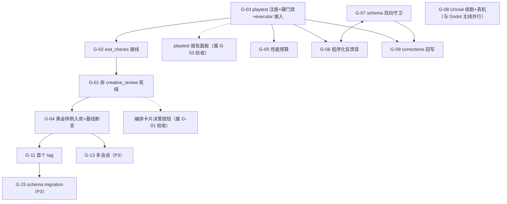

# 缺口清单与推进顺序（P0–P3）

日期：2026-10-13
配套：`gap-assessment-2026-10-13.md`（九维度打分与业界对照）
锚点：**让产出的东西真的可玩、可验证**

每条缺口给四样东西：现状证据（已复现）/ 为什么是这个优先级 / 补齐方向 / **验收判据（可复算）**。验收判据必须是能跑出数字或颜色的命令或测试，不写"提升体验"这类。

## P0 — 不做完，"产出真的可玩可验证"这句话无法被证明

### G-03 playtest 不在执行链，`no_win_path` 只报 warning — **已完成（2026-10-13）**

| 项 | 内容 |
| --- | --- |
| 现状证据 | `grep -c playtest fantasy_agent/executor.py = 0`；`grep -n 'if stage.id == "optimization_testing"' fantasy_agent/workflows.py`（当时 917-925，本批后 965 起）Godot 路由把 `optimization_testing.mcp_tools` 改成 `["validate_godot_project"]`（静态检查）；`generated/playtest/20261002_*` 实测 `win_rate=0.0`、5/5 失败、`status="warning"` |
| 为什么 P0 | **唯一能证明"可玩"的度量器与生产链完全断开。** 且就算接上，今天也只会"记录"不会"阻断"——`no_win_path` 被降为 warning 的理由（"bot 不能代替玩家判断好不好玩"）对"好不好玩"成立，对"**能不能通关**"不成立，这是概念混淆 |
| 方向（原计划） | ① 注册 `playtest_godot_project` 工具；② Godot 路由两个 stage 挂上；③ 硬门禁：`no_win_path` 提到 blocking；④ executor validate 之后调用；⑤ 填 `QAPlan.playtest_report_path` / `playtest_checks` |
| 验收 | ① `grep -c playtest fantasy_agent/executor.py > 0`；② 对黄金切片真机跑一次产出报告；③ `test_the_godot_route_offers_the_playtest_tool`：断言 Godot pipeline 的 `optimization_testing.mcp_tools` 含 `playtest_godot_project`（变异：改回只有 validate → 红）；④ **`win_rate == 0` 时 pipeline 必须 `FAILED` 而非 `DONE`** |

**完成情况与原计划的两处偏差（都是实测逼出来的，不是设计偏好）：**

1. **工具权限档必须是 EXECUTE，不能标只读。** 原计划写 `readOnlyHint=True`，理由是"只读才能挂 `exit_checks`"。但 playtest 真会启动 Godot 并写 probe/report，标只读等于让一个 write grant 就能启动引擎。且 `_run_exit_checks`（`orchestrator.py:683-705`）是**空参调用**且只放行 READ_ONLY 工具，`PlaytestRequest.project_dir` 必填——playtest 结构上就挂不上去。**结论：诚实标 EXECUTE，硬门禁落在 executor 直接调用这一层**（模型经 `mcp_tools` 供参，执行层负责判定），`exit_checks` 留给 G-02。
2. **`run_playtest` 有一个真 bug**：它用 `workspace_root` 定位产物，却把相对 `project_dir` 当 CWD 相对解析。已改为锚定 `workspace_root`（绝对路径仍然尊重）。

**真机验证（本机 Godot 4.6.3 console，黄金切片 `20260713_122217`）挖出三个真空洞，全部已补：**

| 洞 | 实测形状 | 修法 |
| --- | --- | --- |
| `playtest_unmeasured` | 该切片 `game_manager` 从未 `add_to_group("game_manager")`（2026-07-13 早于 M6a），探针按组取不到节点 → **0 runs**、60 次场景重载、烧完 180s 墙钟预算。所有 finding 都被 `aggregate.runs` 守着，于是一条都不触发，报告只有 timeout warning，**执行层判 `done`** | `build_findings` 增加 blocking finding；`_status_for` 同步 |
| `outcome_unreadable` | 给该切片补上组注册后，探针测到 5 个 run，但 `outcome` 全是 `"ended"`（旧工程没有 `last_outcome`）→ 既不赢也不输，`no_win_path` 因"没有失败可数"而沉默，**执行层仍判 `done`**。而真相是该切片**每个 run 都在第 2 帧胜利**：exit 触发区是出口门 `StaticBody3D` 的**子节点**，`body_entered` 撞在父节点自己的碰撞体上 | `READABLE_OUTCOMES` 白名单外的 outcome 一律 blocking |
| artifact 路径不存在 | `run_playtest` 自己生了时间戳会话号，而 executor 把 `generated/playtest/<session>/...` 记成 stage artifact——端到端跑出 `playtest: done` 旁边指着一个人人没创建的目录 | session id 经 `GodotMCPBridge.playtest_project` 穿到 `run_playtest`，并加断言钉住 |

**两个生成物缺陷（当前模板已修，历史切片才有，记录备查）：** ① `game_manager` 不进组（现模板 `gameplay_codegen.py` 的 `_ready()` 有 `add_to_group`）；② exit 触发区是门体的子节点导致第 2 帧假胜利（现模板 `godot_mcp.py` 改为**兄弟节点** + `_on_exit_entered` 只认 `player` 组）。黄金切片是 gitignore 的本地产物，为使其可测量已在本地给它的 `game_manager.gd` 补了一行 `add_to_group("game_manager")`。

**验证数字（可复算）：**

- 全量测试 `scripts/run_tests.py`：**905 passed**。曾有一条 `test_every_payload_entry_exists` 在免构建的树上恒红（`apps/frontend/dist` 是 gitignore 的构建产物，CI 后端 job 没有 Node、永远构建不出它），红的原因是「没人构建」而不是它声称要防的「改名漏 list」——packager 的 `ensure_frontend_built` 在构建期已经响亮处理过这件事。已把「构建产物」声明进 `BUILD_OUTPUTS`，存在性检查跳过它但两个方向都钉住（`BUILD_OUTPUTS ⊆ PAYLOAD` + dist 仍被点名断言），PK1 变异用例证明丢掉前端条目依旧当场红
- 变异 harness `scripts/mutation_check_all_guards.py`：**131/131 caught，源码逐字节还原**（本批新增 PT5 执行层门禁、PT6 未测量、PT7 outcome 不可读、PT8 session id 穿线、PT9 相对路径锚定、X1–X6 六种 planning 静默回归、PK1 打包守卫、T9 换守卫）
- 门禁会分辨，不是永远红：对当前模板新生成的切片端到端跑 `launch_demo(with_gameplay=True)` → 5 runs 全 win、`win_rate=1.00`、玩家移动 16–37m、**执行层 `done`**（仅 `session_too_short` warning，按"bot 不是玩家"的既定政策保持 warning）；对黄金切片 → `playtest_unmeasured` / `outcome_unreadable` → **执行层 `failed`**

### G-02 `exit_checks` 恒空 → 22 条 quality_gates 全是散文 — **已完成（2026-10-13 实现，2026-10-14 四轴 review 修订）**

| 项 | 内容 |
| --- | --- |
| 现状证据（当时） | `grep -n "exit_checks" fantasy_agent/contracts.py` 有字段；`grep -n "_run_exit_checks" fantasy_agent/orchestrator.py` 消费者完整可用（含"未注册工具即判 FAILED"的正确处理）；`grep -n "def _pipeline_stage" -A 30 fantasy_agent/workflows.py` **没有 `exit_checks` 形参** → 生产侧从不填 |
| 为什么 P0 | 没有可判定的出口条件，"可验证"无从谈起。当前 stage 只要 agent 不报错就 `DONE`，`_run_exit_checks` 这段写得再好也是死代码 |
| 方向（原计划） | ① `_pipeline_stage` 加 `exit_checks: list[str] \| None` 并透传；② 先给 Godot 链路填真检查（必须是**只读**已注册工具）：`godot_quick_play` → `playtest_godot_project`，`optimization_testing` → `validate_godot_project` + `playtest_godot_project`；③ 新增契约守卫：每个 `kind=="agent"` 的 stage 的 `exit_checks` 必须非空、且每个名字可解析为只读工具 |
| 验收 | ① `tests/test_pipeline_contract.py` 新增 `test_every_agent_stage_on_the_godot_route_declares_exit_checks`；② 新增 `test_exit_checks_wired.py`：对坏工程跑 `_run_exit_checks(["validate_godot_project"])` 断言 `status == FAILED`，对好工程断言 `outcome.checks == ["validate_godot_project"]`；③ 跑一次 Godot 编排，快照里 **≥2 个 stage 的 `checks` 非空**（今天必然是 0）；④ 变异：删掉 workflows 里任一条 `exit_checks` → 用例①红 |

**完成情况与原计划的两处偏差（都是结构逼出来的，不是设计偏好）：**

1. **`playtest_godot_project` 不能当 exit check，所以测量不在这一层。** 原计划方向②把它挂进 `exit_checks`。但 exit check 是**零参数调用**：`_run_exit_checks` 走完整 registry、不申请 grant、只放行 READ_ONLY 档。playtest 是 EXECUTE 档——它启动 Godot 并写 probe/report，标只读等于让零授权调用启动引擎（`test_playtest_tool_is_registered_as_an_execute_tier_tool` 钉着档位）。挂上去的后果是每个 stage 都因拒授而 failed，与工程好坏无关。**结论：exit check 用 `validate_godot_project`（静态：工程存在、有主场景、有脚本），playtest 的测量留在 G-03 铺的执行层硬门禁。** 为此给 `validate_godot_project` 加了「调用方没给路径时，从本 run 自己的 `godot_plan` 推导」的能力——create 与 validate 共用同一个 `_default_project_dir()`，防止检查通过一个 create 从未写过的目录；显式路径的直调方不受影响。
2. **Unreal 路由今天没有检查，洞被枚举命名而不是藏起来。** 它的两个 validator 需要 run 产出的 manifest 路径，没法零参数自定位；`optimization_testing` 在该路由上没有任何只读工具。`test_the_unreal_route_stages_without_a_check_are_the_named_ones` 把这三个 stage 写成名单：加 stage 会红，给其中任一个接上检查也会红——洞不能静默长大，也不能被"顺手修好"（X6 变异钉住：给 Unreal 接 Godot 检查会验错工程）。

另外，三个 planning 类 stage 的 quality_gates 散文被翻译成三个**只读计算工具**（`fantasy_agent/plan_checks.py`：`verify_gameplay_spec` / `verify_blender_plan` / `verify_comfyui_plan`）。它们不碰网络、不碰文件系统、不二次推导 plan——`probe_comfyui_capabilities` 是唯一能零参数调用的只读工具，但它会把"ComfyUI 没装"（AGENTS.md 承诺支持的降级运行）变成 stage 失败，所以刻意不用。

**验证数字（可复算）：**

- `pytest tests/test_exit_checks_wired.py -q` → 16 passed（坏工程 FAILED / 好工程 `checks == ["validate_godot_project"]` / 坏工程 detail 含 "Main scene does not exist" / 无 plan FAILED / 三个 plan check 正反两向 / 路径只看起来被关住也会红）
- 契约守卫：`pytest tests/test_pipeline_contract.py -q` 全绿，其中 Godot 路由每个 agent stage 都声明 exit_checks，Unreal 路由的无检查 stage 是上述命名名单
- 端到端：`python scripts/g02_e2e_exit_checks.py` → 快照里 **3 个 stage 的 `checks` 非空**（验收要求 ≥2）；输出目录在 `generated/g02-e2e/`（gitignored）
- 变异 harness：全量 **131/131 caught**；其中 X1–X6 对应该段的六种静默回归，PT8/PT9 钉住 session id 穿线与相对路径锚定（G-03 的真实链路）
- **`caught` 不等于证明了**：T9 的守卫在本批之后变成了等价变异（`_pipeline_stage` 现在显式传 `exit_checks=exit_checks or []`，默认值再也到不了任何 stage），已按 harness 的规矩把 guard 改钉到真正读默认值的那条路径上，注释写明了为什么换

### G-01 编排死结：`creative_review` 永久 `AWAITING_HUMAN`

| 项 | 内容 |
| --- | --- |
| 现状证据 | `grep -n 'kind="human"' fantasy_agent/workflows.py`（当时 773，本批后 815）；`orchestrator.py:570-575` 对 human stage **无条件 return `AWAITING_HUMAN`**，且该分支在 :582 `requires_confirmation` 检查**之前**；唯一赋 `DONE` 的路径在 :658 的 dispatch 分支里，human stage 到不了；`pending_confirmations:443-458` 还显式排除 human stage；**没有任何 REST 端点能写 human stage 的决定** |
| 为什么 P0 | 编排板上跑 Godot 路由**必然**永久停在 order=5，`asset_integration` / `godot_quick_play` / `optimization_testing` 全部永久 blocked。编排层对"可玩可验证"的贡献目前是 0 |
| 方向 | ① `contracts.py` 给 `ProductionPipelineStage` 加 `human_resolution: str \| None`；② `orchestrator.py` 新增 `resolve_human_stage(stage_id, decision)`，独立于 `_confirmed` 存 `self._human_decisions`；③ `_advance` 的 HUMAN 分支改为**先查决定**：有 → `DONE` 并把决定写成 artifact（复用 `approval_manifest` 的写路径），无 → `AWAITING_HUMAN`；④ 新增 `POST /api/orchestration/{session_id}/stages/{stage_id}/decision`；⑤ 前端编排卡片加"批准/打回"控件；⑥ `pending_confirmations` 在未决定时也暴露 human stage（否则前端没有入口） |
| 验收 | ① 新增 `tests/test_orchestrator_human_gate.py::test_a_resolved_human_stage_reaches_done_and_unblocks_dependents`；② 端到端跑编排（全 confirm + decision 端点），断言 `GET /api/orchestration/{id}` 的 outcomes 里出现 `godot_quick_play`；③ 变异：把 `_advance` 的 HUMAN 分支改回无条件 return → 用例①红；④ 新端点要么被前端调用、要么进 `KNOWN_WITHOUT_UI` |

### G-04 黄金样例不在版本控制 → "可玩"没有回归基线

| 项 | 内容 |
| --- | --- |
| 现状证据 | `.gitignore:26 generated/*`；`git ls-files generated/ \| wc -l = 1`（只有 `.gitkeep`）；`generated/parkour-demo/` 覆盖 8 stage 中的 7 个；`generated/godot/sessions/20260713_122217/` 是最完整切片 |
| 为什么 P0 | 没有基线，G-01~G-03 修完也无法证明"下一次没退化"。705 个测试里**没有一条**会因最完整的切片被破坏而变红——这是整个测试体系最大的盲区 |
| 方向 | ① 新增 `tests/fixtures/golden/godot-slice/`（**进 git**）：导出 20260713 的源码层产物（`project.godot` / `scenes/` / `scripts/` / `data/` / `fantasy-agent-godot-manifest.json`），**排除 `.godot/` 导入缓存**；二进制资产用 `golden-manifest.json`（路径 + sha256）代替；② `.gitignore` 开白名单 `!tests/fixtures/golden/**`；③ 新增 `tests/test_golden_slice.py`：(a) fixture 工程能被 `validate_godot_project` 静态通过；(b) 关键文件 sha256 与 manifest 一致；(c) **`gameplay_codegen` 对同一 spec 重生成，产物与 fixture 逐字节一致**；④ 把 `20261002_160815` 的 `aggregate` 存为 `playtest-baseline.json` **已知下限**，断言重跑不低于此下限 |
| 验收 | ① `git ls-files tests/fixtures/golden \| wc -l >= 10`；② 手工把 fixture 里任一 `.gd` 改一个字符 → 该测试变红（可当场复算）；③ **CI 无引擎也必须绿**（只做静态校验 + sha256 + codegen 重放）；④ 变异：删掉 `golden-manifest.json` 里任一条 → 红 |

## P1 — 第一批闭环跑通后立刻要补

| ID | 缺口 | 现状证据 | 方向 | 验收 |
| --- | --- | --- | --- | --- |
| **G-05** | 性能预算为零；`wall_msec` 采集了无人消费 | `fantasy_agent/` 性能关键词 **0 命中**；`grep -n wall_msec fantasy_agent/contracts.py`（当时 1115，本批后 1164）无消费者 | ① `contracts.py` 新增 `PerformanceBudget`（`target_fps` / `max_triangles_per_scene` / `max_draw_calls` / `max_asset_bytes` / `max_load_seconds`）挂到 `GodotProjectPlan`；② `blender_codegen.py` 导出时把三角面数写进 asset manifest（照抄已有材质/UV/socket 的 manifest 模式）；③ `godot_playtest.py` 的 probe 加读 `Performance.get_monitor()` 的帧时间 / draw call / object count，进 `PlaytestSample`；④ 新增只读 `inspect_performance_budget` 作为 `optimization_testing` 的 exit_check；⑤ 超预算 → stage `FAILED` | ① `grep -rn "Performance.get_monitor" fantasy_agent/godot_playtest.py >= 1`；② 新用例：构造超预算的假 `PlaytestReport` 断言 exit check 非 ok，合规的断言 ok；③ 实测跑一次，报告出现 `avg_fps` / `draw_calls` / `triangle_estimate` 三个**非 0** 值；④ 落一份默认预算表（Godot 桌面：60fps / 场景 <150k tri / 单资产 <5MB / 冷启动 <5s） |
| **G-06** | 音频零覆盖（窄口径：只补反馈音） | 生成工程 0 个 `AudioStreamPlayer`；schema 无 audio 字段 | ① `GameplaySpec` 加 `audio: AudioDesignSpec`（事件语义：jump/land/hit/checkpoint/win/fail，**语义非文件路径**）；② `gameplay_codegen.py` 生成 `AudioStreamPlayer` 节点 + `audio_bus.gd`，用 `AudioStreamGenerator` 程序化合成——**不引入任何外部音频素材源**；③ probe 加一条：失败/胜利事件是否触发播放，进 `PlaytestSample`；④ **明确不做** BGM、配音、空间音频、音频中间件 | ① 新 session 的 `.tscn` 里 `AudioStreamPlayer >= 1`；② `test_audio_codegen.py`：8 个轴各生成一次，断言每轴 ≥3 个 feedback 事件节点；删掉 `axis_templates.py` 里的 feedback 声明 → 红；③ 报告新增 `audio_events_triggered`，实测跑一次断言 > 0；④ schema 同步加 audio 段并被 G-07 的双向守卫覆盖 |
| **G-07** | `gameplay-schema.yaml` 运行时从不校验 + 三处漂移 | 全仓只有 `scripts/package_desktop.py:81` 把 yaml 当 payload 拷；`jsonschema` 不在依赖；漂移：`mcp_handoffs`（schema 有代码无，且 `GameplaySpec` 是 `extra="forbid"` 会直接拒）、`creative-review-agent`（代码有 schema 无）、`renderer` 默认 `"Godot 4"` 不在自己的 enum 里 | ① 依赖加 `jsonschema`；② 新增 `fantasy_agent/schema_validate.py`；③ 新增 `tests/test_gameplay_schema.py`：`GameplaySpec.model_json_schema()` 与 yaml **双向字段对齐断言**（schema 有代码无 → 红；代码有 schema 无 → 红；默认值必须在 enum 内 → 红）；④ 修三处漂移；⑤ **关键决策**：声明 `contracts.py` 是唯一运行时契约，yaml 降级为"对外发布的 DSL 文档"，由测试保证一致，**不做运行时加载** | ① 测试绿；人为在 yaml 加一个假字段 → 红；给 `GameplaySpec` 加字段不进 yaml → 红；② `grep -n "jsonschema" pyproject.toml` 有结果；③ 不依赖引擎，CI 必须绿。**注意：G-06 要往 schema 加字段，所以 G-07 必须与 G-06 同批或更早** |
| **G-08** | Unreal 路线不可续跑、无真机验证 | `grep -n 'record_stage' fantasy_agent/pipeline_state.py`（当时 67-70，本批后 70-75）注释承认 `execute_unreal_demo` 从不调 `record_stage`；`demo_launch.normalize_demo_resume` 直接抛 "Unreal resume is not wired"；UE 测试全 mock | **限定范围**：只做"能续跑 + 有一条真机证据"，**不做 UE 的 playtest / PIE**。① `execute_unreal_demo`（`grep -n 'def execute_unreal_demo' fantasy_agent/executor.py`，当时 1325，本批后 1453）每一步调 `record_stage`，让 `UNREAL_STAGE_ORDER` 真正生效；② 实现 `normalize_demo_resume`（复用 Godot 的 `stages_before` 逻辑）；③ 加一条 **opt-in 真机**测试，打 `pytest.mark.engine`（本机跑、CI 跳过），参照 `mutation_check_all_guards.py` 已有的 `ENGINE_REQUIREMENTS` 机制：起一次 `UnrealEditor-Cmd` 跑 DataValidation commandlet，断言退出码 0 且日志含 0 blocking error | ① 跑完 `execute_unreal_demo`（mock commandlet）后 `_pipeline_state.json` 存在且含全部 8 个 stage 名；② `--from-stage` 对 Unreal 生效的状态断言（**今天必然红**）；③ `pytest -m engine tests/test_unreal_real_commandlet.py` 在本机绿，关键日志行进 fixtures |

## P2 / P3

| ID | 缺口 | 现状证据 | 判断 |
| --- | --- | --- | --- |
| **G-09** | corrections 只报告不回写（4 字段 / ~50 常量无处可存） | `corrections.py:55-60` `SPEC_BACKED_ANCHORS` 只有 4 项；`ROADMAP.md:79` 采纳回写未勾选 | P2。它与 G-03 天然耦合：playtest finding → `rework_target` → 回写 spec → 重生成 → 重测，这才是真正的 playtest 驱动迭代闭环。方向：先扩 DSL 手感字段（`dash_cooldown` / `jump_velocity` / `gravity` / `enemy_damage` 等 ~15 个），`SPEC_BACKED_ANCHORS` 从 4 提到 ≥20，再实现 `--adopt` 回写并用 diff 验证 |
| **G-10** | 前端呈现与可用性 | `grep -n '<pre>' apps/frontend/src/shared/panels/BlenderScriptPanel.tsx` `<pre>`；`grep ErrorBoundary apps/frontend/src` = 0；只记住一个 session id；无 404 / 离线态 | P2，但**例外**：G-01 的决策按钮 + G-03 的 playtest 报告面板**必须随 P0 一起做**（计入其验收）。其余（GDD/DSL 结构化、`GET /api/sessions` + 会话列表、ErrorBoundary、404、离线态）放 P2 |
| **G-11** | 发布与运营零基建 | `git tag -l \| wc -l = 0`；version 0.1.0；`release.yml` on `push: tags: v*` 从未触发 | P2 且**明确不升 P1**（本地单进程工作台，锚点不是产品化）。但**必须要有版本号**，否则 G-04 的基线与 playtest 报告无法归因。方向：打第一个 `v0.1.0` tag 让 release 真跑一次；`pyproject.toml` version 与 tag 对齐并加守卫。**不做**遥测/崩溃上报，改用本地日志 + 可选"导出诊断包" |
| **G-12** | `publish_prototype_branch` 只有契约无实现 | `tool_registry.unimplemented_contracts()` 自认已知缺口 | **建议删除契约而非实现它**（理由见评估报告否决项）。若要保留，则降级为本地 `export_bundle` |
| G-13 | 多会话持久化与项目会话管理 | 前端只记住一个 session id；后端无 `GET /api/sessions` | P3。排在 G-04 之后才有意义（先有基线，再谈管理多个基线） |
| G-14 | 生成物内文本双语 | `locales/` + `i18n.py` 只服务工作台 | P3。与锚点无关，纯广度 |
| G-15 | 跨版本 schema migration | `ROADMAP.md` M7 已列为后续验证重点 | P3。无 tag、无版本归因（G-11 未做）之前，migration 无从定义 |

## 依赖关系

## 推进顺序

| 批次 | 内容 | 做完这批能证明什么 |
| --- | --- | --- |
| **第 1 批** | **G-03** ✅ 已完成（2026-10-13） | 产出的切片有可玩性数字，且这个数字会**阻断**流水线（今天 `win_rate=0` 只报 warning） |
| **第 2 批** | **G-01 + G-02** | 编排板能真正跑到底，且每个 agent stage 至少有一条机器可判定的出口检查被记录（快照 `checks` 非空） |
| **第 3 批** | **G-04** | "可玩"变成 CI 上可复算、会变红的事实，不再是本机口头结论 |
| **第 4 批** | **G-07 + G-06** | DSL 加字段不再漂移；切片有可听的失败/胜利反馈且被 playtest 观测到（`audio_events_triggered > 0`） |
| **第 5 批** | **G-05 + G-08**（可并行，代码路径不重叠） | 性能有数字和门禁；第二条引擎路线不再是纯 mock |
| **第 6 批** | **G-09 + G-10 + G-11** | 完整迭代闭环（finding → 回写 → 重生成 → 重测）+ 版本归因 + 前端不再是调试级呈现 |
| 第 7 批 | G-12（建议删除）；G-13/14/15 视锚点是否变化再定 | `unimplemented_contracts()` 归零，自认缺口清零 |

**第 1–3 批是 P0**，做完就能回答"产出的东西到底能不能玩、能不能验证"。

### 顺序的三条理由（容易被搞反，单独说）

1. **G-03 与 G-02 可独立于 G-01 完成并验收。** `playtest_godot_project` 经 `mcp_tools` 供参、由 executor 直接调用完成硬门禁（**注意：它不是只读工具**，见 G-03 完成情况第 1 条）；`exit_checks` 的契约守卫也不依赖编排板跑到底。不要因为它们"最终要挂编排板"就等 G-01。
2. **反过来先修 G-01 是净亏。** 打通后 `optimization_testing` 只挂静态 `validate_godot_project`，编排板会一路绿灯跑到底然后说"验证通过"，而它连这个场景能不能通关都不知道。**你会得到一个看起来完成了、实际上什么都没证明的流水线**，这个假象比今天的"卡住"更难发现——卡住至少是可见的。
3. **G-04 必须最后。** 基线的内容是"一条跑到底的编排 + 一份有数字的 playtest 报告"，两者都要先存在。提前做只会把今天这个"跑不通"的状态固化成 baseline。

## 落地时的三条纪律

1. **每条缺口先写验收再写实现。** 这个仓库的规矩是"测试通过"和"读盘确认过内容"是两件事；门禁类改动尤其要跑一次真机再下结论。
2. **G-02 的守卫要测"门槛存在性"，不只是"guard 会不会变红"。** 变异守卫测不了前者，`optimization_testing` 这个 vacuous gate 就是这么逃过去的。**同一个 vacuous 形状在 G-03 的门禁自身上又重复了两次**（0 runs、outcome 不可读），两次都是真机跑出来才发现的，单测全绿。门禁的漏洞很少是"抓不到坏情况"，多是**分不清「没测」和「测过了没事」**——所以每个 finding 都要问一句：这条路径一个样本都没有时，报告长什么样？
3. **打通编排后第一次真跑到 `optimization_testing` 时，前 5 个 stage 的产物很可能拼不成可玩场景。** 那不是回归，是从未验证过；按实测修，不按猜测改。
