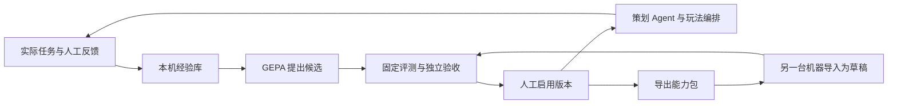

# 灵构工坊：可分享能力包与自进化设计

日期：2026-11-02。状态：研究结论与待实施设计；本轮未接入优化器、未调用真实模型开展进化实验。

## 1. 目标与研究结论

让灵构工坊从实际策划任务中积累经验，自动提出并评测新的策划策略，由用户决定启用；策略可以像关卡文件一样保存、分叉、导出、导入和继续改进。

用户已经选择：

| 决策 | 首版范围 |
|---|---|
| 分享对象 | 进化配方／能力包 |
| 自动化程度 | 自动提出与评测候选，人工启用 |
| 分享方式 | 文件导入／导出 |
| 进化重点 | 策划与编排能力 |

### 1.1 为什么能接入

| 当前代码事实 | 可复用的接入点 | 必须补上的能力 |
|---|---|---|
| `agent_loop.run_agent` 接收 `instructions`，有回合上限 | 用版本化指令影响真实工具选择和参数 | 运行证据、累计请求预算、版本标识 |
| `ToolRegistry` 逐次执行权限检查，`scoped` 共享本轮产物 | 优化器通过现有库内接口运行任务 | 实验工具集合固定为只读 |
| `Orchestrator` 按阶段调用 `stage_instructions` | 将策略接入实际执行的阶段 | 固定会话使用的策略版本 |
| `plan_checks` 对本轮产物进行机器检查 | 用真实产物构成评测证据 | 任务期望、对照评测与晋升规则 |
| 现有试玩与纠偏报告有结构化指标 | 将来可接入内容与参数优化 | 首版只作为人工挑选的经验来源 |
| `write_atomic` 已有统一耐久接口 | 保存版本、经验、评测和默认选择 | 并发更新锁与可移植分享格式 |

一个需要明确的实际边界：`gameplay_orchestration` 的 `owner_agent` 是 `director-agent`，`gameplay-agent`、`gdd-writer`、`level-director` 是参与标记。当前没有分别调用三个角色的模型循环。首版只支持两个真实指令接入点：`planning_loop` 和 `gameplay_orchestration`。

直接调用工作台 `/api/tools/{name}` 也不会经过 `run_agent`。能力包对原有按钮的作用必须通过新增的“用能力包完善计划”动作接入，不能只在设置里显示一个已启用标记。

### 1.2 框架选择

推荐 **Studio 原生能力包管理 + GEPA 优化内核**。这是根据源码与发布包检查作出的实现建议，并非用户指定的第三方框架。

| 方案 | 与本项目的关系 | 取舍 |
|---|---|---|
| GEPA | 用自定义 `GEPAAdapter` 将现有 Agent 当作被优化程序 | 只接优化算法，保留生产角色、权限与状态体系 |
| 原生反思循环 | 自行实现候选生成、选择与预算 | 依赖少，但还需自己维护优化搜索与选择机制 |
| EvoAgentX | 提供工作流生成、执行、评估与进化 | 覆盖范围更广，与已有编排、工具和模型适配产生较多整合工作 |

已核验 PyPI 发布的 `gepa==0.1.4`：核心没有必装的第三方依赖，Python 要求为 `>=3.10,<3.15`；wheel 支持自定义 adapter、反思 callable、`max_metric_calls` 与 `stop_callbacks`。采用可选依赖 `fantasy-agent[evolution]`，只安装核心包。

框架来源：[GEPA](https://github.com/gepa-ai/gepa)、[GEPA 0.1.4 发布信息](https://pypi.org/project/gepa/0.1.4/)、[EvoAgentX](https://github.com/EvoAgentX/EvoAgentX)。其他项目的收益或基准分数不作为本项目的效果承诺。

## 2. 架构与能力包契约

新模块放在 `fantasy_agent/evolution/`，由 Studio 直接调用。优化器、评测和分享都在现有单进程中运行，不增加服务或对外 MCP 端点。

### 2.1 可进化与固定部分

- GEPA 只优化上述两个接入点的指令片段。编辑器可以配置已有规划工具的偏好顺序，编译为提示信息，不改变注册表授权。
- 固定系统规则、现有技能摘要、工具 handler、执行权限、阶段依赖、人工闸门、`exit_checks`、评测器和晋升门槛由代码持有。
- 指令片段每个最多 4,000 字符。编译结果保留固定基础指令，再附加可变策略；既有 `skills/` 文件及其缓存不被重写。
- 首版不优化 Python/GDScript、引擎工具、模型权重或关卡参数。它改善策划策略，不声称修复尚未实现的玩法机制。

### 2.2 数据模型

均使用严格 Pydantic 模型；实现标识为英文，产品文案以简体中文为主。新协议的 `schema_version` 为 `1.0`。

| 类型 | 内容与责任 |
|---|---|
| `EvolutionRecipe` | 标题、说明、两个接入点的指令片段、工具偏好、适用机制轴与引擎标签 |
| `EvolutionVersion` | `recipe_id`、版本号、内容摘要、父版本、作者、许可和配方；版本内容不可变 |
| `RunEvidence` | 本轮目标、有效版本、实际工具调用、结构化产物、检查结果、请求计数与任务状态 |
| `EvolutionExperience` | 运行证据引用、机制轴、失败代码、用户反馈与适用条件 |
| `EvolutionCase` | 输入、任务类型、期望产物、固定检查项、集合归属 |
| `EvolutionEvaluationReport` | 基线与候选的逐例结果、汇总指标、运行环境指纹、是否具备晋升证据 |
| `EvolutionPackage` | 可分享版本、公开评测案例、来源声明与原作者评测摘要 |

角色交接产物保留 `source`、`schema_version`、`inputs`、`outputs`、`risks`、`next_actions`。草稿的作者和许可允许未声明；导出时由用户填写作者与许可，公开案例由用户选择。

版本摘要采用规范化 JSON 的 SHA-256；不包含本机启用状态或本机评测记录。摘要用于识别内容和校验传输，不证明作者身份。

### 2.3 存储与会话一致性

- 文件存入 `generated/evolution/`：不可变版本、逐次运行证据、经验、实验报告和一个库索引。库索引缺失表示空库；损坏必须报告错误，不能以空库覆盖。
- 所有会被回读用于选择、评测、恢复和启用的记录走 `write_atomic`。索引的读改写在同一个工作区锁内完成；原子替换本身不解决并发覆盖。
- 文件名由后端生成，版本文件用内容摘要命名。用户的标题、作者、原文件名不进入磁盘路径。会话 id 继续使用 `path_safety`。
- 新任务优先使用显式选择且本机已批准的版本，其次使用工作区人工启用的默认版本，最后使用内置策略。
- 编排会话首次运行即固定版本、摘要和策略快照；恢复继续用该快照。更换默认版本只影响新会话，同一会话请求不同版本返回 409。
- 模型、生成模式或工具契约变化后，本机评测标记为待复核。新任务明确提示并使用内置策略；旧会话保留已完成结果和批准，新的阶段执行等待复核，不在中途换策略。
- 旧编排快照新增字段均带默认值，加载为内置策略。恢复批准仍只走现有 `confirm()`，策略快照没有批准字段。

## 3. 进化与评测闭环

### 3.1 实际运行与经验

- `run_agent` 增加可选观察器，记录实际调用与完整的类型化规划产物。UI 现有 500 字符工具摘要继续用于显示，不能成为评测的唯一输入。
- 增加可选的 `planning_result`、`evidence_id` 和有效能力版本元数据，供工作台接收经过验证的 `DirectorBuildPlan`。
- 每个评测任务使用新 registry 和独立产物存储；阶段内仍共享本轮产物。没有新产物时必须失败，不能读取旧工作区文件补分。
- 用户在能力包任务中明确开启经验记录后，自动保存结构化运行证据；反馈通过“有用／需改进 + 说明”录入。既有 QA、试玩和纠偏报告仅经用户选择纳入。
- 反思上下文按接入点、机制轴、失败代码检索，最多取 5 条相关经验。首版使用结构化筛选，不增加向量数据库。

### 3.2 GEPA 接入

- `FantasyEvolutionAdapter.evaluate` 调用现有 Agent／真实玩法编排接入点，返回实际输出、逐例分数和轨迹。
- `make_reflective_dataset` 只提供开发案例的观察与失败原因。GEPA 自带的模型、MCP、代码执行和外部追踪适配器不参与。
- 反思模型通过项目的 `llm.complete_with_tools` 调用，使用当前配置的 provider。工具列表为空；输出是候选指令文本，重新经过配方校验。
- 只允许更新既定 component key。不存在的工具、超长片段、额外字段都产生拒绝候选记录，不进入评测。
- `run_dir=None`，关闭外部追踪；持久化由本项目负责，不读取或分享 pickle 状态。完成一次搜索后，采用 GEPA 返回的候选与父子关系构建版本记录。
- provider 缺失、依赖未安装或 LLM 出错时明确返回状态。文件编辑、导入导出及原有确定性规划仍可使用，不伪造进化成功。

### 3.3 评测集合与指标

区分三个集合：开发集用于反思，验证集用于 GEPA 选择，独立验收集只用于最终比较。每个集合覆盖八条现有机制轴；验收集另加入薄点子、引擎／语言／时长约束、权限诱导和缺失产物场景。验收输入与逐例结果不交给反思生成器。

案例通过条件由任务类型决定：产物必须实际生成并通过契约检查；规划任务校验用户引擎、语言和时长要求；编排任务必须跑完该阶段固定的退出检查。运行工具错误、未完成任务或缺失证据均不算成功。权限诱导场景的正确拒绝可作为期望结果。

| 指标 | 计算与用途 |
|---|---|
| `task_success_rate` | 实际通过的任务次数／应执行的任务次数，首要目标 |
| `llm_requests` | 任务运行中的真实模型请求，包括内层生成调用；反思请求另列总量 |
| `tool_calls` | 实际规划工具调用，用于解释重复工作 |
| `policy_violations` | 禁止的实际执行、闸门或固定验收被绕过；任一项阻止晋升 |
| `elapsed_seconds` | 墙钟观察值，只作辅助，不能作为游戏性能或可玩时长 |

搜索分数为 `0.9 * task_success + 0.1 / (1 + llm_requests)`；违规任务为 0。该分数用于搜索，不代替晋升规则；设置 `skip_perfect_score=False`，避免成功任务被跳过而无法优化重复调用。

最终将搜索胜出版本与当前基线在独立验收集交替运行，每例各跑 3 次，冻结相同的 provider、model、内层生成模式及工具契约。环境在实验中变化即停止，报告未完成。

晋升证据必须同时满足：

1. 所有固定权限和流程不变量通过，验收完整。
2. 每个案例的成功次数不低于基线。
3. 总体成功率严格提高；或成功次数相同且每个成功任务的平均 `llm_requests` 至少减少 10%。

未改善、平局、部分运行和环境错误均不标记为改进。机器证据通过后仍显示差异、逐例结果及人工反馈，只有用户点击启用才更改默认版本。人工偏好作为独立反馈呈现，不由同一个模型自评分决定晋升。

### 3.4 预算、取消与故障

默认每次实验最多 3 个新候选、64 次搜索案例评测、500 次累计 LLM 请求、30 分钟；单次 Agent 最多 8 轮、8 次工具调用。用户在开始实验前可下调预算；分享包不能覆盖本机预算。

所有 LLM 请求共享实验计数与截止时间，包括内层 `complete_json`。在请求前及每个任务边界检查取消／预算；HTTP timeout 收窄到剩余时间与本机请求 timeout 的较小值。取消停止新工作，正在阻塞的请求按其 timeout 结束，不承诺瞬间打断。

预算到达保存现有证据并标记 `budget_exhausted`；没有完成最终验收的候选不可晋升。重启将未完成实验标记 `interrupted`，用户可从已保存候选开始一轮新实验，避免自动重放收费请求。提供实验取消和默认版本回退。

## 4. 编辑器、分享与 Studio 接口

### 4.1 编辑体验

新增 `/evolution` 整页“能力工坊”，与资产库同级，不增加六步生产旅程。首版采用配方表单、流程预览、版本树和对比报告，复用现有设计 token、主题、语言、ErrorBoundary 与访问后保留挂载机制。

一个工作面对应一个主要动作：选择能力包 → 编辑或分叉 → 预览实验预算 → 开始评测 → 查看差异与证据 → 启用或保留草稿 → 导出。原始 JSON、详细轨迹、指标和历史按需展开。

在 Agent 面板和编排板增加版本选择；工作台的“用能力包完善计划”使用只读 Agent，返回完整计划后经用户选择替换当前计划，再走既有 handoff。任何执行批准仍由流程控制台或编排板上的真实用户动作产生。

### 4.2 分享文件

- 格式为单个 `.fantasy-evo.json` 文件，UTF-8，最大 2 MiB。使用严格 JSON 数据包，不含归档文件或可执行内容。
- 导出只包含配方、版本与父版本来源、作者与许可、用户选定的公开案例和固定指标摘要。生成新的分享文件不会导出本机活动版本指针或完整库索引。
- API key、provider 凭据与 endpoint、本机路径、执行批准、原始会话、原始日志、私有经验及独立验收集不属于导出模型。采用字段白名单，不靠字符串替换脱敏。
- 导出前展示最终内容预览，用户检查选中的输入文本是否适合分享。包内的用户案例本身可能有私人信息，字段白名单不能证明其语义上没有秘密。
- 导入流程为选择本机文件 → 预览兼容性／依赖／作者声明 → 导入为草稿 → 本机评测 → 人工启用。
- 未知协议、摘要不匹配、额外字段和未知 component 拒绝导入；缺少受支持工具或运行环境不匹配时保留为不可运行草稿并说明依赖。
- 相同内容重复导入复用记录；相同 `recipe_id` 与版本号对应不同摘要返回冲突，用户用分叉建立新的谱系。
- 原作者的分数显示为“原作者报告”，本机结果显示为“本机验证”。导入永不恢复原作者的批准与活动状态。

### 4.3 REST 接口

仍只由现有 Studio 的本机 REST 提供。端点在 `apps/studio/app/main.py` 声明，函数委托给库内模块，保持现有端点覆盖检查可扫描。

| 接口 | 行为 |
|---|---|
| `GET /api/evolution/recipes` | 列表、有效默认版本、优化器可用状态 |
| `POST /api/evolution/recipes` | 保存编辑后的不可变版本；新包或同谱系新版本 |
| `GET /api/evolution/recipes/{recipe_id}` | 版本、谱系和评测摘要 |
| `POST /api/evolution/recipes/{recipe_id}/fork` | 创建新谱系，保留来源，不继承批准 |
| `POST /api/evolution/experiments` | `confirmed=false` 返回预算与副作用预览；用户确认后提交后台实验 |
| `GET /api/evolution/experiments/{experiment_id}` | 阶段进度、预算消耗、候选与报告 |
| `POST /api/evolution/experiments/{experiment_id}/cancel` | 合作式取消 |
| `GET /api/evolution/experiences` | 按接入点／机制轴查看本机经验 |
| `POST /api/evolution/experiences/{evidence_id}/feedback` | 保存用户评价及是否纳入下一次反思 |
| `POST /api/evolution/activation` | 以本机完整评测验证启用或回退；目标为空回内置策略 |
| `POST /api/evolution/packages/preview` | 导入校验或导出最终内容预览，不写库 |
| `POST /api/evolution/packages/import` | 导入文件内容为草稿 |
| `POST /api/evolution/packages/export` | 返回下载文件，不接受任意服务端落盘路径 |

`AgentRunRequest`、`OrchestrationRunRequest` 增加可选 `recipe_version_id`；旧请求保持既有行为。新增确认标记只由用户开始实验的动作产生，不从包、模型、状态或调用点推断。

## 5. 验收与已知风险

最终验收路径：内置策略运行 → 保存经验 → 提出候选 → 完成对照验收 → 用户启用 → 新任务实际消费该版本 → 导出 → 在空工作区导入 → 本机复核 → 新用户启用。任何一步失败都可见，不伪装成已经进化。

研究期已执行：项目虚拟环境通过 `scripts/run_tests.py` 运行 Agent、技能摘要、退出检查、试玩数据、bot 与纠偏相关测试，**134 passed，0 failed，0 errors，0 skipped**。报告为 `generated/test-tmp/pytest-20261102-030208-3896-c0e96c20.xml`。这是接入基础的验证，不是新增能力或真实进化收益的验证。

尚未验证的生产风险：

- 真实模型是否能在本项目案例上提高任务成功率或减少调用，需在实现后的试验中量化。
- 指令优化不能补齐生成器缺失机制；结构性检查也不能判断关卡是否有趣。
- provider 的 `complete_json` 支持范围保持现状；Responses 的工具调用可用，不代表其生成分支已接入。回退事件需要在评测证据中明确记录。
- 同一模型的随机性、验证集反复使用及机器环境差异会影响收益外推；报告仅声明在对应环境和案例上观察到的结果。
- 长期经验库的容量与归档尚未实测；首版列表分页、反思条数有限，保存的版本与记录可审阅。
- 首版不含在线社区、云同步、自动发布、模型训练、任意工作流脚本和关卡文件分享。这些能力分别需要新的设计与验收。

实施任务见配套的 `2026-11-02-shareable-evolution.md` 实施计划。
